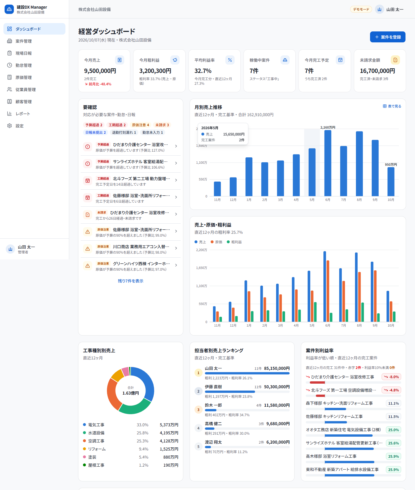
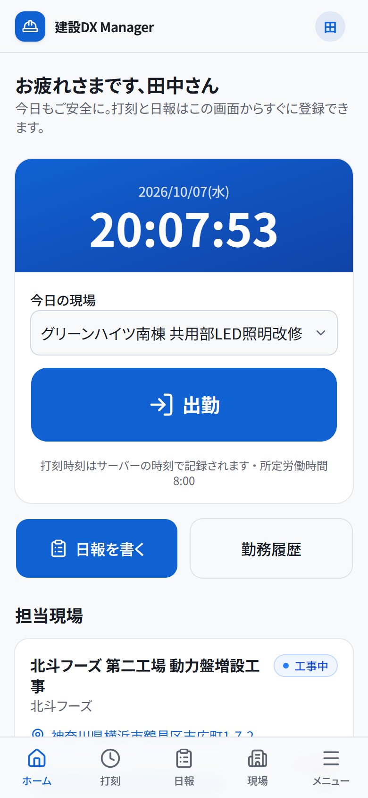
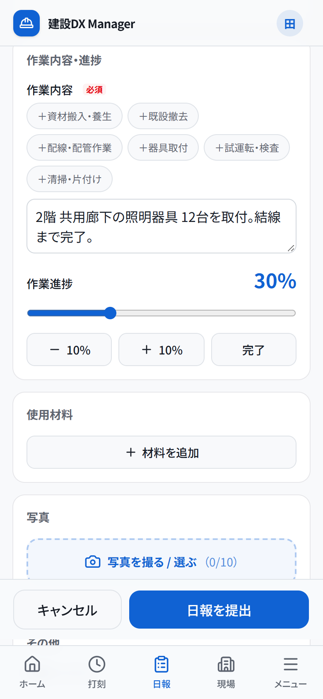
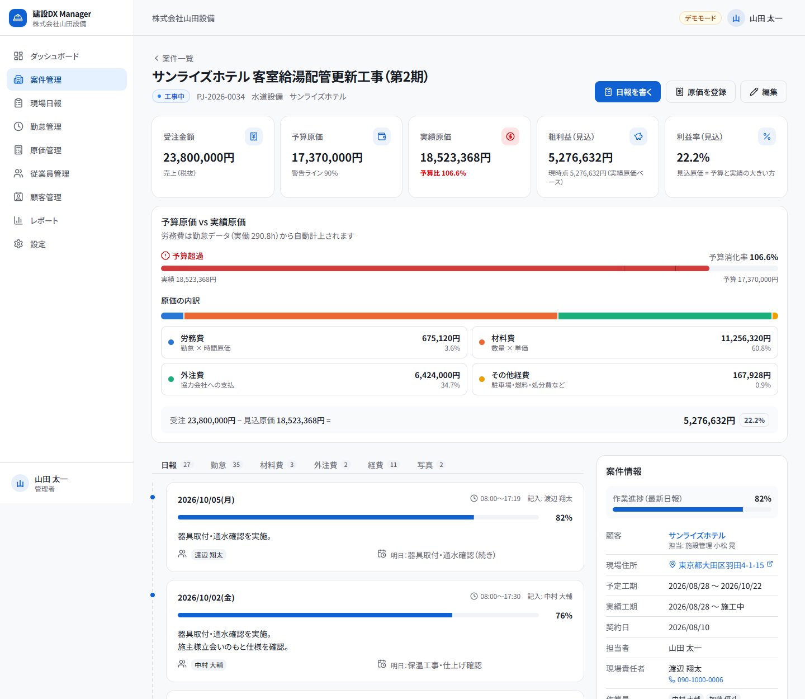
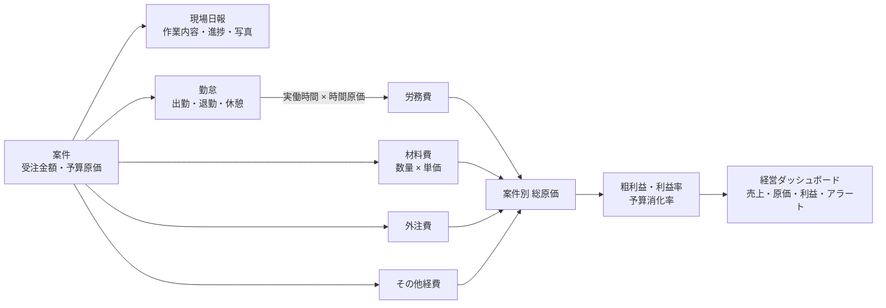

# 建設DX Manager

中小規模の建設会社・設備工事会社向けの **業務DX管理システム** です。
「案件登録 → 現場作業 → 日報 → 勤怠 → 原価 → 売上・利益」を **案件ID を中心に一元管理** し、
工事ごとの利益と会社全体の経営状況をリアルタイムに把握できるようにします。

### 🔗 公開デモ: https://kensetsu-dx-manager.vercel.app

ログイン画面の「デモアカウントでログイン」から、管理者・現場責任者・一般スタッフの各役割で操作できます（パスワードはすべて `demo1234`）。
現場スタッフの画面はスマートフォンでの表示もお試しください。データは毎日 4:00（日本時間）に初期状態へ戻ります。

> デモ企業「株式会社山田設備」（従業員13名・顧客16社・案件49件・約13ヶ月分の勤怠/日報/原価）のデータ入りで、
> ローカルでも `npm install && npm run dev` だけで全機能を操作できます（Supabase の準備は不要）。
>
> 構成: Vercel（東京リージョン）+ Supabase（東京リージョン / PostgreSQL・Auth・Storage）



| 現場スタッフのホーム（スマートフォン） | 日報入力（スマートフォン） | 案件詳細（予算 vs 実績） |
| --- | --- | --- |
|  |  |  |

---

## システム概要

| 項目 | 内容 |
| --- | --- |
| 対象 | 10〜50名規模の建設会社・設備工事会社（電気・空調・水道設備・リフォーム・塗装・屋根・土木・工務店） |
| 利用者 | 経営者・事務（管理者）／現場責任者／現場スタッフ |
| 端末 | PC・タブレット・スマートフォン（現場スタッフはスマホでの打刻・日報入力を想定） |
| 言語・地域 | 日本語 UI、日付 `YYYY/MM/DD`、24時間表記、`1,234,567円`、日本時間（Asia/Tokyo） |

### 解決する課題

| Before（よくある現状） | After（建設DX Manager） |
| --- | --- |
| 現場日報が **紙**。事務所で回収・転記 | スマホで写真付き日報を1分で提出。案件ごとに時系列で自動集約 |
| 勤怠が **タイムカード / Excel**。月末に手集計 | 出勤・退勤ボタンで打刻。実働・残業時間を自動計算 |
| 案件台帳・原価が **Excel に二重入力** | 勤怠から労務費を自動計上。材料費・外注費・経費も案件に紐付け |
| 工事ごとの **原価・利益が分からない** | 予算原価 vs 実績原価、粗利益・利益率を案件ごとにリアルタイム表示 |
| 売上・利益を **月末に集計** | 経営ダッシュボードで今月の売上・粗利・未請求をいつでも確認 |
| 問題に **気づくのが遅い** | 工期超過・原価超過・未請求・日報未提出・勤怠漏れを「要確認」に自動表示 |

### データの流れ（案件ID が中心）



---

## 主な機能

### 1. 案件管理
- 案件の登録・編集・削除（案件ID は `PJ-年-連番` で自動採番）
- 一覧で **売上・原価・粗利益・利益率** を一目で確認（完工前の案件は「見込」原価で算出）
- 検索（案件名・顧客名・案件ID・住所）とフィルター（ステータス・担当者・工事種別・期間）・並び替え
- 案件詳細で日報・勤怠・材料費・外注費・経費・写真・売上・利益を確認
- **予算原価 vs 実績原価** のメーター（90% で警告、超過で赤色＋アイコン＋文言）と原価内訳

### 2. 現場日報（スマートフォン最適化）
- 日付・案件・作業者（ワンタップ選択）・作業時間・休憩・作業内容（定型文ボタン）・進捗（±10%ボタン）
- 使用材料（行の追加・削除）、問題・トラブル、明日の予定、備考
- **写真アップロード**（施工前／施工中／施工後）。ブラウザ側で縮小・圧縮して送信、サーバー側でファイル形式を検証
- 案件詳細から時系列のタイムラインで確認

### 3. 勤怠管理
- 大きな **出勤／退勤ボタン**（サーバー時刻で記録）。前日の退勤打刻漏れはその場で修正
- 実働時間 = 退勤 − 出勤 − 休憩、残業時間 = 実働 − 所定労働時間 を自動計算（DB の生成列・ビュー）
- 管理者向け **月次勤怠**：従業員ごとの出勤日数・総労働時間・残業時間・労務費・案件別作業時間、勤怠の修正・追加

### 4. 原価管理
- 労務費：勤怠 × 従業員の時間原価で自動計上（時間原価は管理者のみ参照可能な別テーブル）
- 材料費（数量 × 単価を自動計算）・外注費・その他経費（駐車場・高速代・ガソリン・重機・レンタル・廃材処分 等）
- 総原価・粗利益・利益率・予算消化率を自動計算。案件別の予算 vs 実績一覧

### 5. 経営ダッシュボード（管理者のトップ画面）
- KPI：今月売上・今月粗利益・平均利益率・稼働中案件・今月完工予定・未請求金額
- グラフ：月別売上推移（12ヶ月）・売上/原価/粗利益の比較・工事種別別売上（円グラフ）・担当者別ランキング・案件別利益率
- **要確認**：工期超過・原価が予算の90%超／超過・完工済み未請求・勤怠未入力・退勤打刻漏れ・日報未提出
- **導入効果（Before / After）** のシミュレーション（※デモ企業を想定した試算）

### そのほか
- 従業員管理（権限・時間原価・在籍状況）、顧客管理（過去案件・累計売上）、レポート（表形式・CSV ダウンロード）、設定（所定労働時間・原価アラート閾値）
- 現場責任者・スタッフには「現場ホーム」（打刻・担当現場・最近の日報）を表示

---

## 権限

| 機能 | 管理者 | 現場責任者 | 一般スタッフ |
| --- | --- | --- | --- |
| 経営ダッシュボード・レポート | ○ | — | — |
| 案件 | 全件の閲覧・編集 | 担当案件の閲覧 | 担当現場の閲覧 |
| 現場日報 | 全件 | 担当案件の閲覧・登録 | 自分の日報の登録・閲覧 |
| 勤怠 | 全員の閲覧・修正 | 自分の打刻・担当現場の作業員 | 自分の打刻・勤務履歴 |
| 材料費・外注費・経費 | 全件 | 担当案件の登録・閲覧 | — |
| 利益・時間原価 | ○ | — | — |
| 従業員・顧客・設定 | ○ | 従業員の閲覧のみ | — |

画面の表示制御だけでなく、**PostgreSQL の行レベルセキュリティ（RLS）で同じ範囲に制限** しています（`supabase/migrations/20261001000200_rls.sql`）。

---

## 技術構成

| 分類 | 技術 |
| --- | --- |
| フレームワーク | Next.js 16（App Router / Server Components / Server Actions / Proxy） |
| 言語 | TypeScript（strict） |
| UI | Tailwind CSS v4、shadcn/ui（Radix UI）、Lucide Icons、Recharts |
| バックエンド | Supabase（Auth・PostgreSQL・Storage） |
| DB | PostgreSQL（マイグレーション SQL・ビュー・RLS）。デモモードは PGlite（WASM 版 PostgreSQL） |
| DB ドライバ | postgres.js（Supabase）／ PGlite（デモ） |
| バリデーション | Zod |
| テスト | Vitest（計算ロジック・入力検証・SQL・実DB での原価計算と RLS） |

### アーキテクチャの特徴

- **すべてのクエリが RLS 付きで実行される**：サーバー側でトランザクションを開始し、`authenticated` ロールへ切り替えて JWT クレーム（`auth.uid()`）を設定してから実行します。アプリのバグがあっても DB が権限外のデータを返しません。
- **2つの動作モードで同じ SQL を使う**：`APP_MODE=demo` では PGlite（本物の PostgreSQL を WASM 化したもの）をプロセス内で起動し、本番と同じマイグレーション・RLS・ビューを適用します。デモでも本番と同じ挙動になります。
- **金額は誤差ゼロ**：金額は `numeric(14,0)`（円単位の整数を10進数で厳密に保持）。材料費は DB の生成列 `round(数量 × 単価)`、画面のプレビューは 100 倍した整数で計算し、PostgreSQL の端数処理と一致させています。
- **原価計算は DB のビューに集約**：`v_attendance`（実働・残業・労務費）、`v_project_costs`（総原価・粗利益・利益率・予算消化率）。テストで TypeScript による独立した再計算と突き合わせています。
- **日本時間で処理**：業務日付は `YYYY-MM-DD` 文字列、DB セッションのタイムゾーンは `Asia/Tokyo`。サーバーが UTC で動いても日付がずれません。

詳しい設計は [docs/ARCHITECTURE.md](docs/ARCHITECTURE.md) を参照してください。

---

## セットアップ

### 必要環境
- Node.js 20.9 以上（推奨: 24 LTS）

### デモモード（Supabase 不要・おすすめ）

```bash
npm install
npm run dev
```

http://localhost:3000 を開き、ログイン画面の「デモアカウントでログイン」から役割を選んでください。

- データはサーバーのメモリ上にあり、**再起動または日付の変更で「今日」を基準にした初期データに戻ります**（設定画面から手動で初期化も可能）。
- 永続化したい場合は `.env.local` に `DEMO_DATA_DIR=./.data/pglite` を設定します。
- 本番ビルド：`npm run build && npm start`

> **補足**：`npm run dev` / `npm run build` は互換性を優先して webpack を使用しています。Turbopack を使う場合は `npm run dev:turbo` を実行してください。

### Supabase モード（本番構成）

1. [Supabase](https://supabase.com/) でプロジェクトを作成します（リージョンは Tokyo 推奨）。
2. `.env.example` をコピーして `.env.local` を作成し、`APP_MODE=supabase` と Supabase の各値を設定します。
3. マイグレーションを適用します（テーブル・ビュー・RLS・Storage バケット）。
   ```bash
   npm run db:migrate
   # または Supabase CLI: supabase link --project-ref <ref> && supabase db push
   ```
4. デモデータとデモアカウントを投入します（任意）。
   ```bash
   npm run db:seed
   ```
5. `npm run build && npm start`（Vercel 等にデプロイする場合は同じ環境変数を設定）。

本番運用でユーザーを追加する場合は、Supabase Auth でユーザーを作成し、`public.users` に `（auth ユーザーID, 従業員ID）` を登録します。

### 公開デモとして運用する（Vercel + Supabase）

デモアカウントを公開する場合は、次の環境変数を追加します。

| 変数 | 値 |
| --- | --- |
| `DEMO_RESET_ENABLED` | `true`（ログイン画面にデモアカウントを表示） |
| `CRON_SECRET` | 32文字以上のランダム文字列 |

`vercel.json` の Cron により、毎日 4:00（日本時間）に `/api/cron/reset-demo` が実行され、デモデータが「今日」を基準にした初期状態へ戻ります（閲覧者が登録・削除したデータもリセットされます）。関数のリージョンは Supabase と同じ東京（`hnd1`）に設定しています。

---

## 環境変数

`.env.example` を参照してください。

| 変数 | 必須 | 説明 |
| --- | --- | --- |
| `APP_MODE` | — | `demo`（既定）または `supabase` |
| `AUTH_SECRET` | 本番推奨 | デモモードのセッション署名キー（32文字以上） |
| `DEMO_DATA_DIR` | — | デモモードのデータ保存先（未指定ならメモリ） |
| `NEXT_PUBLIC_SUPABASE_URL` | supabase | Supabase の Project URL |
| `NEXT_PUBLIC_SUPABASE_ANON_KEY` | supabase | anon（public）キー |
| `SUPABASE_SERVICE_ROLE_KEY` | supabase | service_role キー（サーバー専用。写真ストレージと Seed で使用） |
| `DATABASE_URL` | supabase | PostgreSQL 接続文字列（Transaction pooler 推奨） |
| `DEMO_RESET_ENABLED` | — | `true` で公開デモ運用（デモアカウント表示・毎日初期化） |
| `CRON_SECRET` | 公開デモ | デモデータ初期化エンドポイントの認証キー |

---

## デモアカウント

パスワードはすべて **`demo1234`** です。

| 役割 | メールアドレス | 氏名 | 主な確認ポイント |
| --- | --- | --- | --- |
| 管理者 | `admin@yamada-setsubi.example` | 山田 太一（代表取締役） | 経営ダッシュボード、案件の利益率、原価管理、月次勤怠、レポート |
| 現場責任者 | `manager@yamada-setsubi.example` | 鈴木 一郎（工事一課 課長） | 担当案件、作業員の出勤状況、材料費・経費の登録 |
| 一般スタッフ | `staff@yamada-setsubi.example` | 田中 太郎（電気工事士） | 出勤・退勤の打刻、写真付き日報（スマートフォン幅で確認推奨） |

### デモデータの見どころ
- **さくら内科クリニック 空調設備更新工事**：受注 5,800,000円・原価 4,060,000円・利益 1,740,000円・利益率 30.0%
- **ひだまり介護センター 浴室改修工事**：赤字（−8.0%）かつ完工済み・未請求
- **サンライズホテル 客室給湯配管更新工事（第2期）**：工事中に原価が予算を超過（106.6%）
- **北斗フーズ 第二工場 動力盤増設工事**：工期超過・原価が予算の92%・日報未提出
- 高利益案件（40%超）・低利益案件（10%台）・失注・見積中の案件、退職者・休職者も含みます
- 日付はすべて「今日」からの相対値で生成されるため、いつ起動しても直近12ヶ月の推移とアラートが自然に表示されます

---

## 開発用コマンド

| コマンド | 内容 |
| --- | --- |
| `npm run dev` | 開発サーバー（デモモード） |
| `npm run build` / `npm start` | 本番ビルド / 起動 |
| `npm run typecheck` | TypeScript の型チェック |
| `npm run lint` | ESLint |
| `npm test` | Vitest（単体テスト + PGlite を使った DB 統合テスト） |
| `npm run check` | 型チェック + ESLint + テスト |
| `npm run demo:check` | デモDB を起動し、件数・原価・権限ごとの見え方を表示 |
| `npm run db:migrate` | Supabase にマイグレーションを適用 |
| `npm run db:seed` | Supabase にデモデータとデモアカウントを投入 |

---

## ディレクトリ構成

```
├── supabase/migrations/      スキーマ・ビュー・RLS・Storage の SQL（唯一の正）
├── scripts/                  マイグレーション・Seed・デモDB確認スクリプト
├── docs/                     設計ドキュメント・スクリーンショット
├── tests/                    Vitest（計算・検証・SQL・DB統合/RLS）
├── public/demo-photos/       デモ用の現場写真（SVG）
└── src/
    ├── app/
    │   ├── (auth)/login/     ログイン
    │   ├── (app)/            ダッシュボード・案件・日報・勤怠・原価・従業員・顧客・レポート・設定
    │   └── api/              写真配信（認可付き）・CSV ダウンロード
    ├── components/           ui（shadcn）/ layout / common / 機能別コンポーネント / charts
    ├── lib/                  日付・金額・勤怠計算、表示フォーマット、Zod スキーマ、定数
    ├── server/
    │   ├── db/               SQL タグ関数・PGlite / postgres.js ドライバ・マイグレーション読込
    │   ├── auth/             セッション（デモ / Supabase Auth）・権限ガード
    │   ├── queries/          画面ごとのデータ取得（RLS 付き）
    │   ├── actions/          Server Actions（登録・更新・削除）
    │   └── seed/             デモデータ生成（株式会社山田設備）
    └── proxy.ts              未ログイン時のリダイレクト・Supabase セッション更新
```

---

## セキュリティ

- 全クエリを `authenticated` ロール + RLS で実行（サービスロールは Seed と Storage 操作のみ）
- Server Actions で権限を再確認し、入力は Zod で検証。SQL はすべてプレースホルダでバインド
- 時間原価（給与関連）は管理者のみ参照可能な別テーブルに分離
- 写真は非公開ストレージに保存し、RLS で閲覧権限を確認してから配信。ファイル形式はバイナリのシグネチャで判定
- CSV 出力は CSV インジェクション対策済み。ログイン試行回数の制限、セキュリティヘッダー（`X-Frame-Options` 等）

## 既知の制約・今後の拡張

- デモモードのデータはメモリ上のため、サーバーレス環境（複数インスタンス）では共有されません。公開デモを長期運用する場合は Supabase モードを推奨します。
- 担当案件の受注金額は、現場責任者・スタッフが API を直接呼べば参照できます（画面には表示しません）。金額の列レベル秘匿はビュー分離で対応予定です。
- 今後の拡張候補：請求書・入金管理、見積書作成、実行予算の費目別管理、工程表（ガントチャート）、写真台帳の PDF 出力、複数会社対応（マルチテナント）、オフライン入力。
