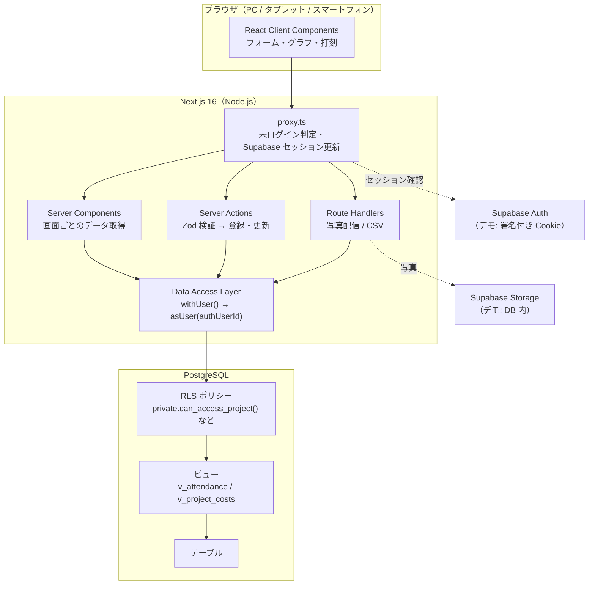
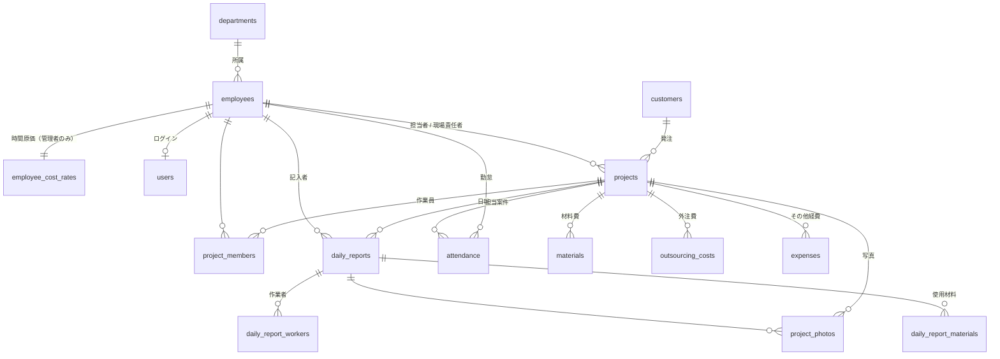

# 設計ドキュメント

## 1. システム全体設計



### リクエストごとの DB アクセス

1. Cookie から認証ユーザーID を取得（Supabase: `auth.getClaims()` で JWT を検証／デモ: HMAC 署名付き Cookie を検証）
2. トランザクションを開始し、次を実行
   ```sql
   select set_config('role', 'authenticated', true),
          set_config('request.jwt.claims', '{"sub": "<user id>", "role": "authenticated"}', true),
          set_config('TimeZone', 'Asia/Tokyo', true);
   ```
3. 以降のクエリは `auth.uid()` を使った RLS ポリシーで自動的に絞り込まれる

管理者専用の画面・操作は `requireRole("admin")` でも確認し、二重に防御しています。

### 動作モード

| | デモモード（`APP_MODE=demo`） | Supabase モード（`APP_MODE=supabase`） |
| --- | --- | --- |
| DB | PGlite（WASM 版 PostgreSQL、プロセス内） | Supabase PostgreSQL（postgres.js、Transaction pooler） |
| スキーマ | `supabase/migrations/*.sql`（Storage 以外） + 互換レイヤー（`auth` スキーマ・ロール） | `supabase/migrations/*.sql` |
| 認証 | scrypt ハッシュ + HMAC 署名 Cookie | Supabase Auth（`@supabase/ssr`） |
| 写真 | `demo_storage.objects`（bytea） | Storage の非公開バケット `project-photos` |
| データ | 起動時に「今日」基準の Seed を投入 | `npm run db:seed` で投入 |

どちらのモードでも **同じマイグレーション・RLS・ビュー・クエリ** が動くため、デモで確認した挙動がそのまま本番の挙動になります。

## 2. ディレクトリ構成

README の「ディレクトリ構成」を参照してください。設計上の原則は次のとおりです。

- `src/lib`：クライアント・サーバー共通の純粋関数（計算・フォーマット・検証）。テストしやすいよう副作用を持たない
- `src/server/queries`：読み取り専用。画面単位でまとめ、型付きの結果を返す
- `src/server/actions`：Server Actions。入力検証 → 権限確認（RLS）→ 更新 → `revalidatePath`
- `src/components`：`ui`（shadcn）／`common`（汎用）／機能別。Server Component を基本にし、操作が必要な部分だけ Client Component

## 3. DB 設計



| テーブル | 主な列 | 備考 |
| --- | --- | --- |
| `settings` | 会社名・所定労働時間・既定休憩・原価アラート閾値 | 1行のみ（`check (id = 1)`） |
| `departments` | 部署名・並び順 | |
| `employees` | 従業員ID（自動採番）・氏名・ふりがな・メール・電話・所属・役職・権限・入社日・在籍状況 | メールは大文字小文字を区別しない一意制約 |
| `employee_cost_rates` | 時間原価 | 給与関連のため別テーブルで管理者のみ参照可 |
| `users` | `auth.users.id` ↔ 従業員 | Supabase Auth との紐付け |
| `customers` | 顧客名・法人名・担当者・連絡先・住所・メモ | 累計売上・過去案件は集計で算出 |
| `projects` | 案件ID・案件名・顧客・現場住所・工事種別・担当者・現場責任者・受注/見積金額・予算原価・契約日・予定/実績の着工日・完工日・ステータス・メモ | 完工以降は実績完工日が必須（check 制約） |
| `project_members` | 案件 × 作業員 | 複合主キー |
| `daily_reports` | 日付・案件・記入者・開始/終了・休憩・作業内容・進捗%・問題・明日の予定・備考 | 案件×記入者×日付で一意 |
| `daily_report_workers` / `daily_report_materials` | 作業者 / 使用材料（数量・単位） | |
| `project_photos` | 撮影区分（施工前/中/後）・保存パス・形式・サイズ・キャプション | |
| `attendance` | 従業員・日付・担当案件・出勤・退勤・休憩・**実働分（生成列）** | 従業員×日付で一意 |
| `materials` | 日付・材料名・数量・単位・単価・**金額（生成列）**・仕入先 | 金額 = `round(数量 × 単価)` |
| `outsourcing_costs` | 日付・外注先・作業内容・金額 | |
| `expenses` | 日付・費目（駐車場/高速代/ガソリン/重機/レンタル/廃材処分/その他）・金額 | |

- 主キーは UUID、業務上の番号（案件ID・従業員ID・顧客コード）は別列でシーケンス採番
- 金額は `numeric(14,0)`、数量・単価は `numeric(10,2)`/`numeric(12,2)`、日時は `timestamptz`
- すべての外部キー列にインデックス、日付での絞り込み列に複合インデックス
- すべての業務テーブルに `created_at` / `updated_at`（`updated_at` はトリガーで自動更新）

### ビュー（`security_invoker = true`：呼び出しユーザーの RLS が適用される）

| ビュー | 計算内容 |
| --- | --- |
| `v_attendance` | 残業時間 = max(0, 実働 − 所定労働時間)、労務費 = round(時間原価 × 実働分 ÷ 60) |
| `v_project_costs` | 労務費・材料費・外注費・その他経費・総原価・粗利益・利益率・予算消化率 |

### 売上計上の考え方

- **工事完成基準**：ステータスが「完工・請求済・入金済」の案件を、実際の完工日の月に売上計上
- 未請求金額 = ステータス「完工」（請求前）の受注金額合計
- 完工前の案件の利益率は、途中の原価で過大に見えないよう **見込原価 = max(予算原価, 実績原価)** で表示（「見込」と明記）

## 4. 権限（RLS）

判定関数は API に公開されない `private` スキーマに `security definer` で定義しています。

| 関数 | 内容 |
| --- | --- |
| `private.current_employee_id()` | ログインユーザーの従業員ID（退職者は NULL） |
| `private.current_app_role()` | 権限（admin / manager / staff） |
| `private.can_access_project(id)` | 管理者、または現場責任者・担当者・案件メンバーなら true |
| `private.is_daily_report_worker(id)` | 日報の作業者か（日報 ⇔ 作業者のポリシー相互参照による再帰を回避） |

代表的なポリシー：

- 勤怠の登録・更新は本人の **当日・前日分のみ**（打刻と退勤漏れの修正）。過去分の修正は管理者
- 材料費・外注費・経費は現場責任者が **担当案件に本人名義でのみ** 登録可能
- 日報の閲覧はスタッフなら自分が記入・参加したもののみ
- `anon` ロールには全テーブルの権限を与えない

`tests/database.test.ts` で、権限ごとに「見える範囲」「拒否される操作（SQLSTATE 42501）」を実 DB で検証しています。

## 5. 実装順序

1. 雛形（Next.js・Tailwind・shadcn/ui）と開発環境
2. マイグレーション（スキーマ → ビュー → RLS → Storage）と DB アクセス層、PGlite で RLS を先に検証
3. デモデータ生成（シナリオ定義 → 勤怠の割り当て → 労務費 → 目標原価に合わせた材料費・外注費・経費 → 日報・写真）
4. 認証・権限ガード・proxy
5. レイアウト（PC サイドバー / スマートフォン下部ナビ）と共通コンポーネント
6. 案件 → 日報・写真 → 勤怠 → 原価 → ダッシュボード → 従業員・顧客・レポート・設定
7. 型チェック・ESLint・単体/統合テスト・本番ビルド・E2E（PC / スマートフォン幅）

## 6. デモデータの生成方法

`src/server/seed/project-specs.ts` に案件シナリオ（受注金額・予算比・原価比・工期・ステータス）を定義し、
`generate.ts` が「今日」を基準に次の順で生成します。

1. 工期とステータスから日程を決定（土日・年末年始・GW・お盆は休業）
2. 案件ごとの 1 日あたり必要人工を求め、工期中の案件に作業員を割り当てて勤怠を作成（労務費が決まる）
3. 目標原価 − 労務費 − 経費 を、工種ごとの構成比で材料費（数量 × 単価）と外注費に配分
4. 勤怠のある案件×日ごとに日報（工程に沿った作業内容・進捗・材料・トラブル）を作成

この方法により、完工案件の実績原価はシナリオで狙った値と **1円単位で一致** します（テストで検証）。
